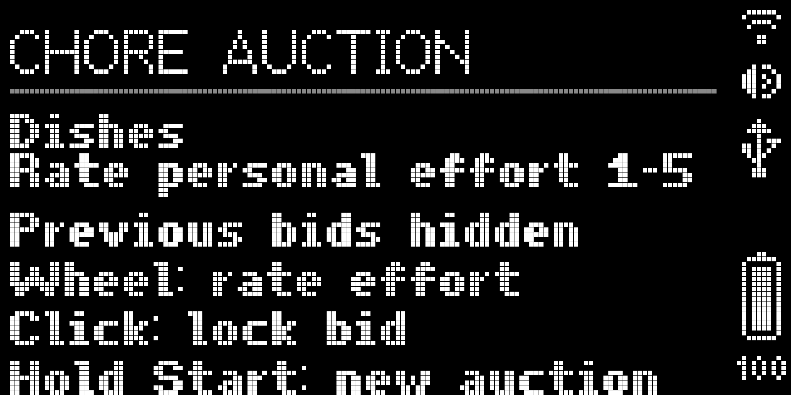
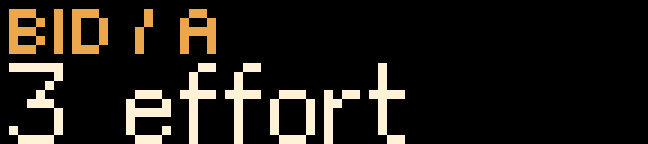

# Chore Auction

Let two people bid on three chores privately, then split the work by estimated effort.

Two people can divide three jobs based on how much work each job feels like to them. A chore that takes one person little effort can move to them even if the task counts end up uneven.

## Screen transitions

Enter the bids, then switch to the proposed division of chores.


<details>

<summary>Watch the rear display</summary>



</details>

## Record both sets of bids

1. Enter three chore names in settings. Player A rates each from one to five using the wheel, then clicks to lock the value.
2. Read the current chore on the rear. When **Pass the bar** appears, hand it to player B. Click to start the second set of bids.
3. Player B rates the same tasks. Earlier bids are hidden on the bidding screen.



## Review the suggested split

1. After the sixth bid, the front shows a chore and the player assigned to it.
2. Turn the wheel to read all three allocations. The recording moves from Dishes assigned to B to Shopping assigned to A.
3. Hold **Start** when both players want a fresh round. New bids let you try a different split after circumstances change.


## Example from the emulator

Every candidate split gives both players at least one job. The app chooses the split with the lowest larger personal effort total. If two splits tie there, the one with the smaller combined effort wins.

## Run in the emulator

Open BUSY Bar Emulator. From this repository, run:

```sh
~/.busy-emulator/bin/busy-emulator dev --once
```

Press **Back** to exit.

The GIFs are excerpts from the emulator recording. Each LED occupies a 16 × 16 cell with a black border. The end frames pause for reading.

[Full recording](media/controls.mp4) · [Rear display](screenshots/back-1.png) · [Firmware test](EMULATOR-QA.md) · [MIT license](LICENSE)
